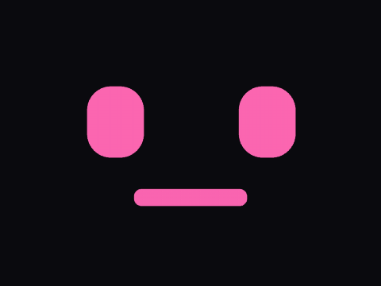
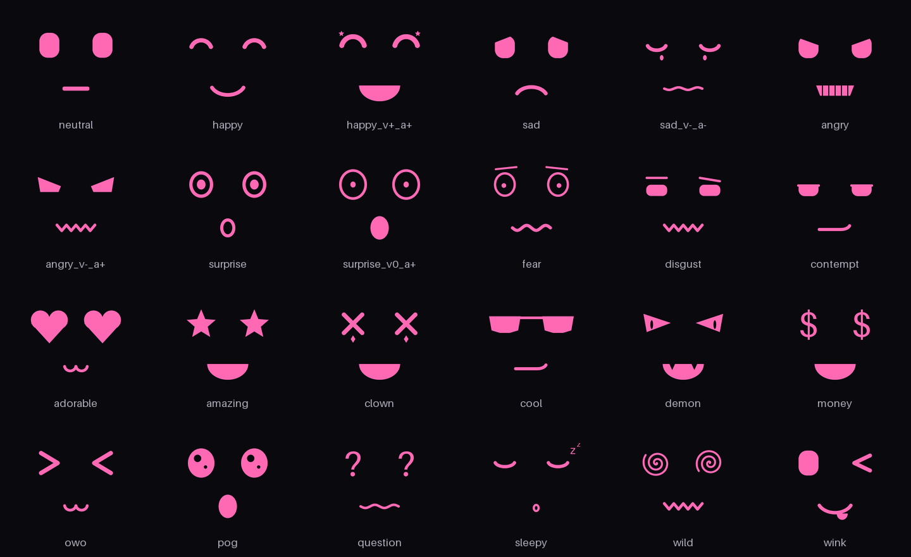
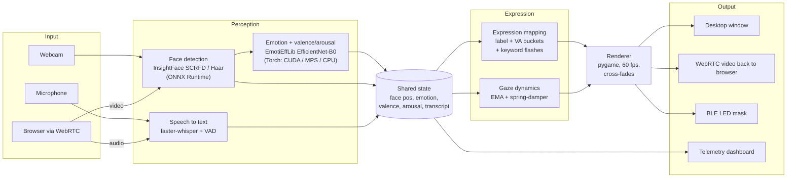

# maskcast

**Your face, as an anime LED mask, in real time.**

maskcast watches you through a webcam, reads your expression with a neural emotion model, listens for keywords with Whisper, and drives a cartoon screen-face that looks where you look and emotes when you emote. The rendered face can go to a desktop window, stream back to any browser over WebRTC, or upload frame by frame to a Bluetooth LED mask you actually wear.



*Recorded with `--demo`: the real renderer driven by a scripted performance, so no camera and no faces involved.*

## What it does

- **Face tracking on any GPU.** InsightFace SCRFD runs through ONNX Runtime and picks the fastest provider the machine has: CoreML on Apple Silicon, DirectML on Windows (AMD, Intel or NVIDIA), CUDA or ROCm on Linux. An OpenCV Haar cascade takes over when none of that is installed.
- **Emotion and affect, not just labels.** EmotiEffLib's EfficientNet-B0 multi-task head predicts 8 emotion classes *and* continuous valence/arousal from each face crop. The face picks art from all three: `happy` at high valence and arousal gets a bigger grin than a mild `happy`.
- **Speech-triggered expressions.** faster-whisper transcribes a rolling 6-second window with VAD. Say "wow" and the eyes turn to stars; say "make it rain" and they become dollar signs.
- **Eyes that feel alive.** Gaze runs through a spring-damper with tuned natural frequency and damping, velocity and acceleration clamps, a jitter deadzone and EMA-smoothed tracking. When you leave the frame the eyes hold your last position, then ease back to centre.
- **WebRTC remote mode.** Open the built-in page on a phone or laptop: its camera and mic stream to the maskcast host, which tracks, transcribes and renders, then streams the face back as live video. Round-trip latency is measured over a data channel.
- **Wearable output.** A BLE client speaks the AES-framed upload protocol of "Shining Mask" style LED face masks, with a newest-frame-wins queue so the mask never lags behind you.
- **Live telemetry.** An optional matplotlib dashboard plots valence, arousal, class probabilities, face position, transcript and per-stage latency.
- **Original procedural art.** All 24 expressions are drawn in code from pills, arcs and polygons, so you can restyle or recolour the whole set with one command.



## How it works



Each stage runs on its own thread (the plotter gets its own process) and they meet at a small shared blackboard, so a slow model never stalls the 60 fps render loop. Face detection runs every frame; the heavier emotion model runs at 2 Hz with exponential smoothing. [docs/architecture.md](docs/architecture.md) walks through each stage.

## Quickstart

The demo needs nothing beyond numpy and pygame:

```bash
git clone https://github.com/joey12725/maskcast && cd maskcast
python -m venv .venv && source .venv/bin/activate
pip install -e .
maskcast --demo
```

For the full pipeline, run the installer. It picks the right Torch and ONNX Runtime wheels for your OS and accelerator and pulls in Whisper, WebRTC and BLE support:

```bash
python scripts/install.py
maskcast                      # webcam + mic, desktop window
```

Model weights (SCRFD, EmotiEffLib, Whisper) download on first run.

Press `q` or `Esc` to quit.

### Stream to a browser

```bash
maskcast -o remote.enabled=true -o remote.host=0.0.0.0
```

Open `http://<host>:8080/` on another device on your network. Browsers only grant camera access on `localhost` or HTTPS, so for a phone put the server behind an HTTPS tunnel or reverse proxy.

### Wear it

```bash
pip install -e ".[mask]"
maskcast -o mask.enabled=true
```

maskcast scans for a BLE device whose name starts with `Mask` and streams every rendered frame to it.

## Hardware

| Platform | Face detection | Emotion model | Whisper |
|---|---|---|---|
| macOS, Apple Silicon | ONNX Runtime CoreML | Torch MPS | CTranslate2 auto (int8) |
| Windows, AMD / Intel / NVIDIA (including handhelds like the ROG Ally X) | ONNX Runtime DirectML | Torch CUDA or CPU | CUDA float16 or CPU int8 |
| Linux, NVIDIA / AMD | CUDA / ROCm | Torch CUDA | CUDA float16 |
| Anything else | CPU or Haar cascade | CPU | CPU int8 |

Backend selection is automatic and logged at startup.

## Bring your own avatar

The renderer treats near-black pixels as transparent and crops each image to its art, so any black-background PNG works. Drop files into `assets/eyes/` and `assets/mouths/`:

| File name | Shown when |
|---|---|
| `happy.png` | the model says happy (any of the 8 classes: `angry contempt disgust fear happy neutral sad surprise`) |
| `happy_v+_a+.png` | happy, with valence and arousal both above their thresholds (`+`, `0` or `-` per axis) |
| `money.png` | someone says a phrase from the `money` keyword list |
| `neutral.png` | fallback for anything without art |

Lookup goes from most specific to least: `happy_v+_a+`, then `happy`, then `neutral`. Keyword phrases live in `maskcast/expressions.py`. A keyword is active whenever an eyes image with that name exists.

To restyle the built-in set:

```bash
pip install -e ".[art]"
python scripts/generate_assets.py --color 7fffd4
```

## Configuration

Everything lives in [`configs/default.json`](configs/default.json), and any value can be overridden from the command line with a dotted path:

```bash
maskcast -o asr.whisper_model=large-v3 -o tuning.gaze_zeta=1.0 -o plots.enabled=true
```

[docs/configuration.md](docs/configuration.md) lists every key, including the gaze and expression tuning knobs.

## Project layout

```
maskcast/
  app.py           wiring: threads, queues, outputs
  video.py         camera loop: detection, emotion, valence/arousal
  detectors.py     SCRFD via ONNX Runtime, Haar fallback
  emotions.py      EmotiEffLib wrapper
  asr.py           faster-whisper rolling-window transcription
  expressions.py   label/VA/keyword -> asset selection (pure)
  motion.py        gaze target + spring-damper (pure)
  render.py        pygame renderer, keying, cross-fades
  remote.py        aiohttp + aiortc WebRTC server
  mask.py          BLE LED mask protocol + client
  plotter.py       telemetry dashboard
  artgen.py        procedural expression art
  demo.py          scripted driver for --demo
  hw.py            accelerator and provider selection
scripts/           installer, asset generator, demo recorder
tests/             pytest suite (runs headless, no ML deps)
```

## Development

```bash
pip install -e ".[dev]"
ruff check . && pytest
python scripts/record_demo.py      # regenerate docs/demo.gif
python scripts/contact_sheet.py    # regenerate docs/expressions.png
```

The tests cover expression selection, gaze dynamics, config handling, the LED mask packet framing, and a headless render of every shipped asset.

## Tech stack

Python, ONNX Runtime, InsightFace, PyTorch, EmotiEffLib, faster-whisper (CTranslate2), OpenCV, pygame, aiohttp, aiortc/PyAV, bleak, pycryptodome, matplotlib, Pillow.

The screen-face look is inspired by the LED-faced hero of the anime *To Be Hero X*. All artwork here is original. Pretrained models are fetched from their upstream projects at runtime and keep their own licenses (InsightFace's model packs are for non-commercial research use).

## License

MIT. Built by [Joey Hersh](https://github.com/joey12725).
